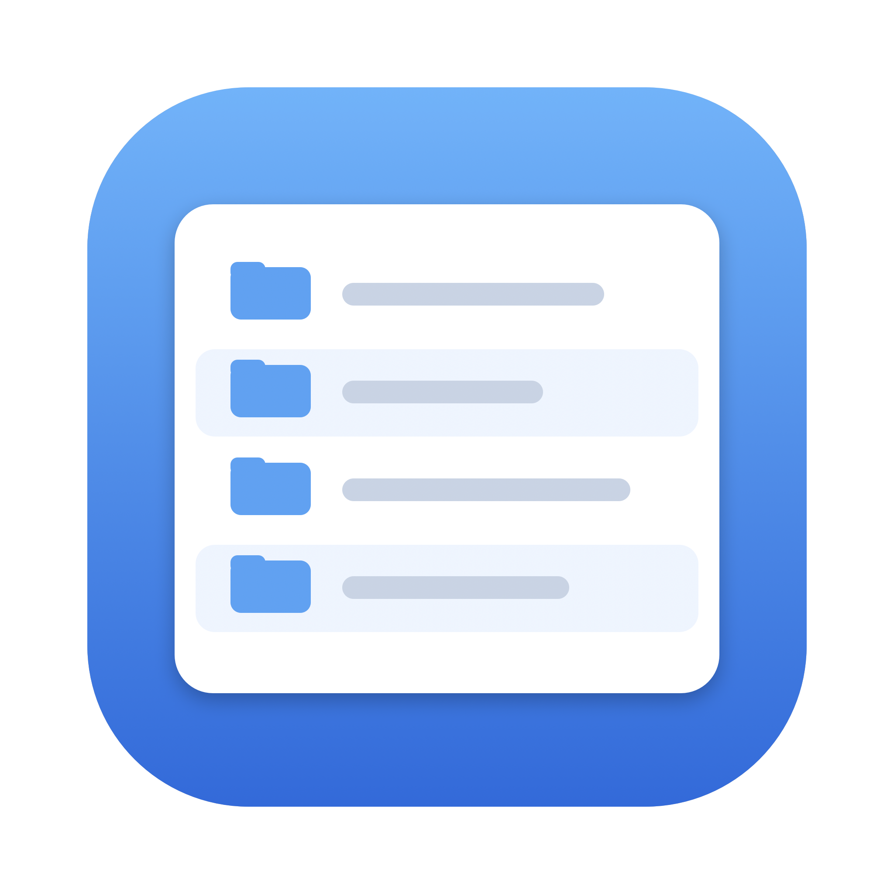

# Explorer

Explorador de archivos para macOS, para usar en lugar de Finder. Swift + AppKit, sin dependencias.



- Siempre en vista de lista, con tamaño recursivo de las carpetas.
- Favoritos en la barra lateral, arrastrando como en Finder.
- Botón derecho: copiar ruta, nueva carpeta/archivo, abrir con, abrir terminal aquí (Ghostty), abrir en den.
- Ruta completa editable con autocompletado por tab.
- Cortar/copiar/pegar como en Windows/Linux, `cmd+z` para deshacer.
- `⌥⌘E` abre una ventana desde cualquier sitio.

## Instalar

```
./install.sh
```

Compila, firma con tu certificado Apple Development (si tienes uno) e instala en `~/Applications/Explorer.app`.

El plan completo y los atajos están en [docs/PLAN.md](docs/PLAN.md).
