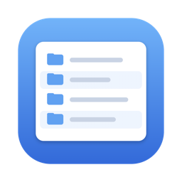
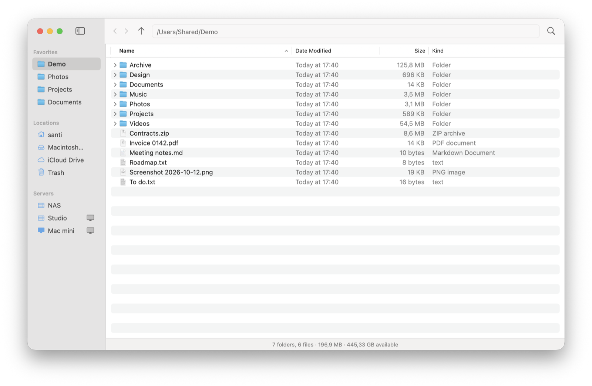
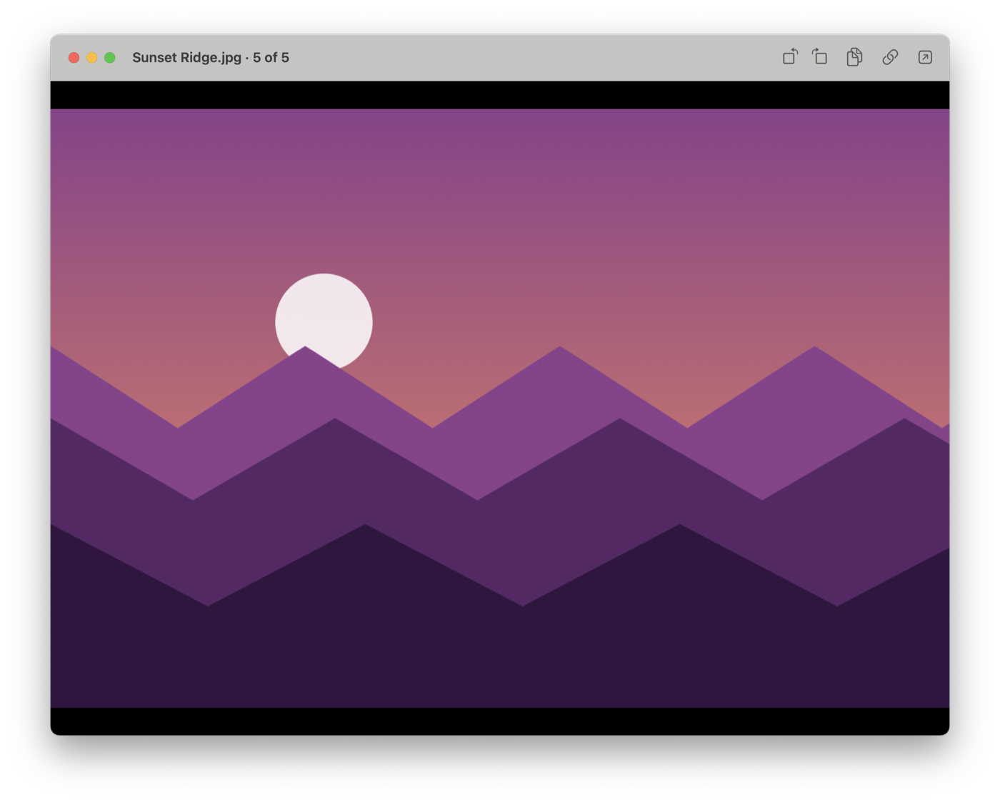

er<p align="center"></p>

# Explorer

A fast, no-nonsense file browser for macOS, built to replace Finder for everyday use. Native Swift + AppKit, no dependencies.



## Why

- **Always a list.** Name, date, size and kind — no icon views, no galleries.
- **Real folder sizes.** Recursive sizes computed in the background, right in the Size column.
- **Status bar**: the folders and files in the folder and its size, or the count and size of the selection, and the free space.
- **Copy Path everywhere.** Every right-click menu has it.
- **New Folder / New File anywhere.** Right-click empty space to create in the current folder, or a folder to create inside it.
- **Editable path bar** with shell-style Tab completion.
- **Cut and paste like Windows/Linux** (`⌘X` / `⌘V`), with full undo (`⌘Z`).
- **Favorites sidebar**, drag folders in and reorder them like in Finder.
- **Servers in the sidebar**: a click opens another machine's disk (`smb://`), a button opens its screen (`vnc://`).
- **Open Terminal Here** (a new Ghostty window by default) and **Open in den**.
- **`⌘E` from anywhere** opens a new window, like Win+E. You can change it in Settings.
- **Replaces Finder for "Show in Finder"**: other apps reveal files and folders in Explorer. Turn it off in Settings. Apps already running pick it up after a restart.

## Built-in previewer



Press Space (or double-click an image or a video) to open the previewer. ← / → move through the files of the folder in list order.

- **Images:** rotate with `⌘L` / `⌘R` (saved instantly; JPEGs only get their EXIF orientation changed, never recompressed), copy the image with `⌘C`, copy its path with `⌥⌘C`, pinch or double-click to zoom.
- **Video:** mp4, mov, m4v and anything else macOS can play, streamed from disk so multi-GB movies open instantly. Formats macOS can't play (mkv, avi…) open in VLC when it's installed.
- **Everything else:** PDFs, text, audio, Office documents… through the system preview, inside the same window.

Any file type can be set to always open in the previewer, or in a specific app, from the **Always Open .ext With** menu. These choices live in Explorer and don't change Finder's defaults.

## Install

Requires macOS 14 or later and the Xcode command line tools.

```
git clone https://github.com/scorredoira/explorer.git
cd explorer
./install.sh
```

This builds the app, signs it with your Apple Development certificate if you have one (ad hoc otherwise), installs it to `~/Applications/Explorer.app` and opens it. Explorer adds itself to your login items so the shortcut always works; turn that off in Settings.

Tip: give Explorer **Full Disk Access** (System Settings → Privacy & Security) so it can show folder sizes everywhere without permission prompts.

## Shortcuts

| Shortcut | Action |
|---|---|
| `⌘E` (global, changeable in Settings) | New window from any app |
| `⌘N` | New window on the same folder |
| `⇧⌘N` / `⌥⌘N` | New folder / new file |
| Enter | Rename |
| Space | Preview |
| `⌘↓` / `⌘↑` | Open / enclosing folder |
| `⌘[` / `⌘]` | Back / forward |
| `⌘X` `⌘C` `⌘V` | Cut, copy, paste files |
| `⌘Z` / `⇧⌘Z` | Undo / redo |
| `⌘⌫` | Move to Trash |
| `⌥⌘C` | Copy path |
| `⌥⌘T` | Open terminal here |
| `⌘L` / `⇧⌘G` | Edit path |
| `⌘F` | Filter the current folder |
| `⇧⌘.` | Show/hide hidden files |
| `⌘Y` | macOS Quick Look |

The full feature list is in [docs/PLAN.md](docs/PLAN.md).
